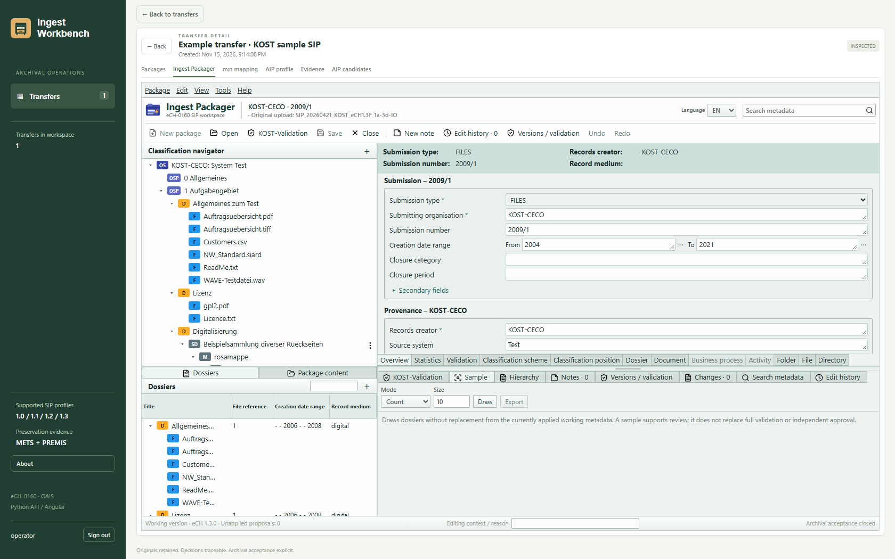

# Ingest Workbench

Python/FastAPI and Angular reference workflow for eCH-0160 SIP intake, preparation, and one AIP candidate per transfer (one or more SIPs). This is not a production archival acceptance system.



[Read the illustrated user manual](docs/user-manual.md) for a step-by-step tour of receipt, preparation, review and candidate generation.

Optional SIP-Validation relies on the separately operated
[sip-validator companion service](https://github.com/baddonkey/sip-validator).

Independent archivist review is off by default. Set
`AIP_REQUIRE_INDEPENDENT_REVIEW=true` to require it before candidate creation.
See [candidate creation and AIS Turbo bridge handoff](docs/user-manual.md#arrange-review-and-build)
for the exact download workflow and external-acceptance boundary.

This is a private, non-commercial educational project exploring ingest tools and the potential of agentic programming.

The project is available under the [MIT License](LICENSE), which permits commercial use. See [third-party notices](THIRD_PARTY_NOTICES.md) for bundled material.

Project version 0.0.1 is recorded in [pyproject.toml](pyproject.toml), the frontend package metadata and the API. Python dependencies remain in the backend requirements files.

Read the [specification](docs/specification.md) for the architecture, data layout, behavioral contract, operating rules and current limitations. The user manual is practical guidance, not a separate specification.

## Start with Podman

Requires rootless Podman and the `podman-compose` provider; Windows also needs a running Podman Machine. For first setup, copy `.env.example` to `.env` only if `.env` does not already exist, then run `python scripts/install_schemas.py`. The local non-container workflow uses Python 3.12 and Node 24.

On Windows, from the repository root:

```powershell
./scripts/start_local.ps1
```

On Linux, set `PODMAN_COMPOSE_PROVIDER=podman-compose`, run `podman compose config`, then start with `podman compose up --build -d`. Do not use Docker. Preserve existing `.env` settings and named volumes.

Open the workbench at `http://localhost:4200`, API docs at `http://localhost:8000/docs`, and Keycloak at `http://localhost:8080`.

The container watches frontend source and public assets for changes. Angular applies updates or reloads the browser as needed; polling supports Podman on Windows. Rebuild and recreate the stack after changing frontend dependencies, Angular configuration, or backend code.

The Transfers overview supports searching by title or status and sorting the results by title, status, SIP count or revision. More results load as you scroll; the **Load more transfers** button is also available. Select a transfer to open its workspace; use **Back to transfers** to return. Creating a transfer opens its workspace immediately.

The displayed transfer date is its recorded creation time. Transfer details show each SIP's original ZIP filename, when retained, and its enclosing folder inside the ZIP, when present.

## Verify

First download the eight separately distributed reference SIPs as described in
the [fixture setup instructions](docs/specification.md#reference-sip-fixtures).
The corpus qualification and backend tests require these exact files.

```powershell
python scripts/install_schemas.py
python scripts/qualify_corpus.py
PYTHONPATH=backend python -m unittest discover -s backend/tests -v
npm --prefix frontend ci
npm --prefix frontend run build
npm --prefix frontend run test:browser
```

See the [specification](docs/specification.md#purpose-and-boundary) for acceptance boundaries and current implementation limits.
