# Ingest Workbench user manual

This guide walks an archivist through a local reference workflow: receiving
eCH-0160 submissions, inspecting and preparing them, arranging dossiers, and
generating AIP candidates. It uses the English interface; some workspace
controls also offer German, French and Italian.

> **Important:** This is an educational reference application, not a production
> archival acceptance system. Receipt checks, optional SIP validation,
> independent review, candidate authorization, institutional approval and
> archival acceptance are different decisions. Building a candidate does not
> deposit it in a repository or accept it in a descriptive system.

The [specification](specification.md) defines the product contract and local
operations. The [gap list](gap-list.md) describes incomplete and unqualified
features. Screenshots in this guide show an isolated demonstration transfer
using a KOST reference SIP; names, counts and dates will differ in your work.

## Contents

- [Get started](#get-started)
- [Receive a SIP](#receive-a-sip)
- [Explore the Ingest Packager](#explore-the-ingest-packager)
- [Prepare metadata and structure](#prepare-metadata-and-structure)
- [Inspect validation results](#inspect-validation-results)
- [Freeze, validate and select a prepared version](#freeze-validate-and-select-a-prepared-version)
- [Arrange, review and build](#arrange-review-and-build)
- [Evidence and preservation context](#evidence-and-preservation-context)
- [Troubleshooting](#troubleshooting)

## Get started

1. Start the local stack as described in the [README](../README.md#start-with-podman).
   On Windows, run `./scripts/start_local.ps1` from the repository root.
2. Open [the workbench](http://localhost:4200/) and sign in through Keycloak.
   The local example realm provides an operator, a reviewer and an auditor;
   credentials and roles are development-only and may have been changed in
   an existing realm. Use your configured account.
3. Use an operator account to create transfers and prepare submissions. An
   independent authorized reviewer is needed for review and authorization;
   a reader can inspect evidence but cannot perform operator actions.

The **Transfers** overview lets you search by title or status and sort by title,
status, SIP count or revision. Select a row to open it. Scroll the list or use
**Load more transfers** for additional results. **Refresh** reloads current
data; the list is not a frozen snapshot.

To try the same kind of example shown below, obtain the eCH 1.3 FILES reference
SIP using the [fixture instructions](specification.md#reference-sip-fixtures).
The sample ZIPs are distributed separately. For your own work, use a SIP you
are authorized to inspect; do not upload sensitive material to a shared demo.

## Receive a SIP

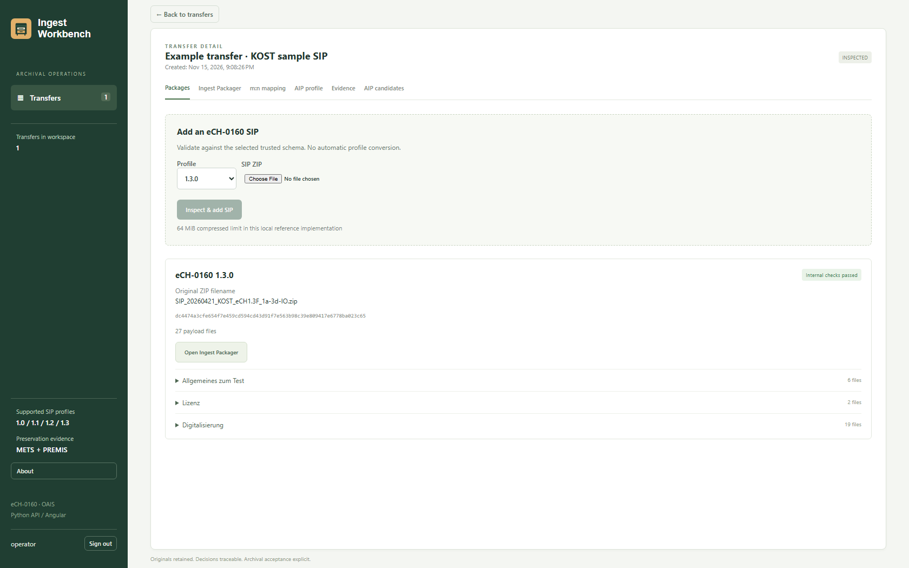

1. In **Transfers**, enter a **New transfer title** and select **Create**.
   The new transfer opens at **Packages**.
2. Under **Add an eCH-0160 SIP**, select the profile declared by the
   submission, choose the ZIP and select **Inspect & add SIP**. The local
   compressed upload limit is 64 MiB.
3. Read any error or finding before continuing. On success the SIP card shows
   **Internal checks passed**, the original upload filename, SHA-256 digest,
   payload count and top-level dossiers. Expand a dossier to inspect its
   submitted metadata.
4. Repeat for additional SIPs in the same transfer while receipt remains
   available. Each SIP keeps its own profile and source evidence.

Select the actual eCH profile: the workbench does not automatically upgrade
submissions. Internal checks include ZIP safety, trusted schema validation,
submitted fixity, inventory and references. A pass is not a format-validation
verdict or archival acceptance. The original bytes remain retained.

## Explore the Ingest Packager

Select **Open Ingest Packager** on a SIP card.

| Area | Use |
| --- | --- |
| **Classification navigator** | Expand or collapse the classification hierarchy and select a record or referenced file. |
| **Dossiers** | Browse dossier descendants and referenced files, with reference, date and medium columns. |
| **Package content** | Browse the physical package and its folder/file hierarchy. |
| Upper-right editor | View the currently selected object's fields; **Secondary fields** reveals more available fields. Select another object in the navigator to switch; there are no open-object tabs to manage. |
| Lower-right tools | Open SIP-Validation, sampling, notes, changes, metadata search or edit history. Object creation and reordering controls open through the navigator actions. |
| Bottom status bar | See pending proposals and enter the **Editing context / reason** used for attributable actions. |

The **Classification scheme** form shows **Name**, **Generation**, **Period of
use**, **Shared use** and **Remarks**, in that order. Other available fields
remain under **Secondary fields**.

Under **Secondary fields**, **Additional metadata** shows a read-only summary
with an **Edit additional metadata...** button. The dialog edits characteristic
names and values; add or remove rows as needed. **Cancel** (or Escape) leaves
the current proposal unchanged. The dialog's **Save** updates the pending
proposal; use **Save** in the main toolbar and provide an editing reason to
persist it. Each compact row contains a name, value and remove button; the
full-width **+ Characteristic** button adds another row.
Removing every row removes the optional additional-metadata container.

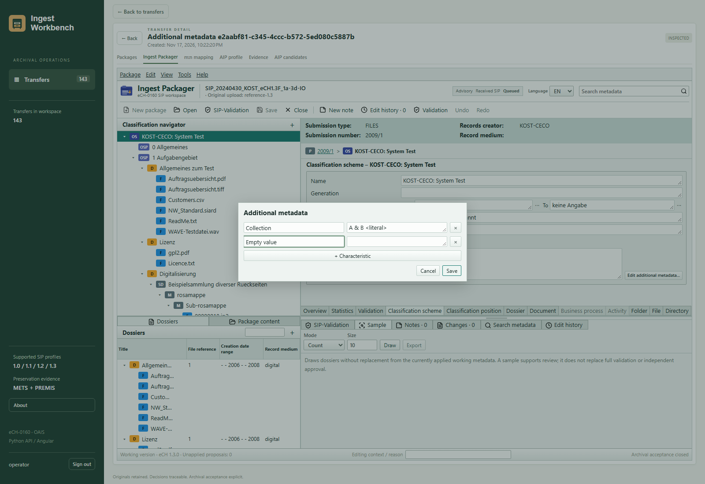

The **File** form shows **Name** and **ID** first. Expand **Secondary fields**
for **Properties**, **Original name**, **Checksum algorithm** and **Checksum**,
in that order. Name, ID and fixity fields remain protected. **Edit file
properties...** uses the same compact name/value dialog and pending-proposal
workflow as additional metadata; removing every row removes all properties.

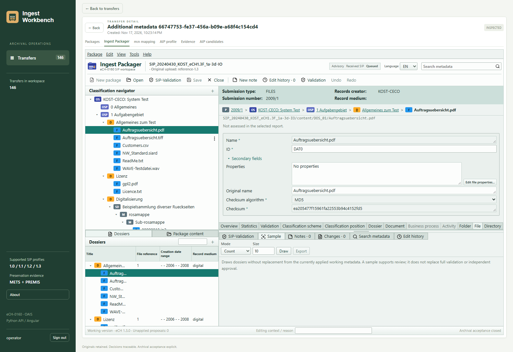

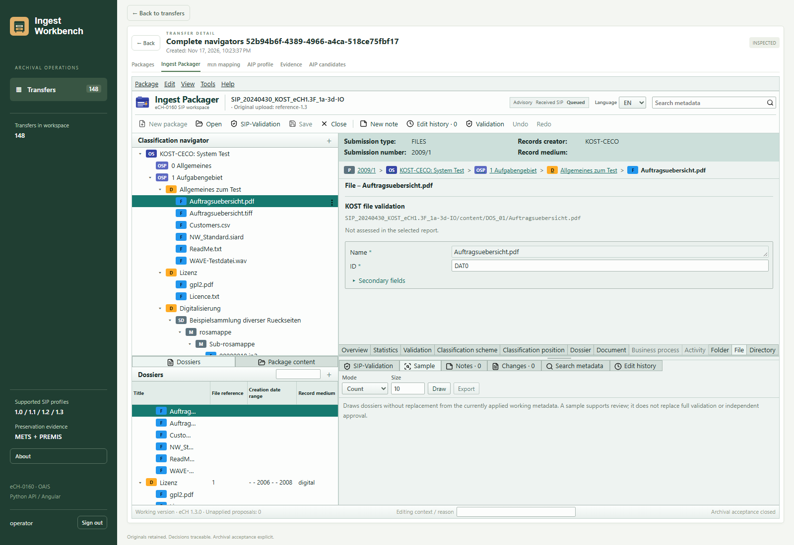

The navigators are independently scrollable. Expand branches to follow nested
dossiers, folders, documents and files. Selecting an item in the classification
navigator reveals and scrolls to it in the active Dossiers or Package content
view, expanding its ancestors and clearing a filter if it hides the selection.
The view switches only if the item is available exclusively in the other view.
The same file can appear
under more than one logical owner without becoming a different file.
The breadcrumb trail below the package summary shows the selected object's
path, with type badges and separators. Click an ancestor to open its metadata;
the final item marks the current object. The path follows the navigator used
to select the object, so logical references and physical package paths remain
distinct.
Use the horizontal splitter between the editor and tools to give either pane
more space. The search box in the lower navigator filters that navigator;
**Search metadata** searches applied metadata values in the lower-right tools
pane, leaving both navigators and the editor visible. The query and match count
sit above the results table. Selecting an object name opens its metadata in the
editor without closing the search or discarding its results. The header search
box opens the same search pane; results update as you type.

Expand **Search filters** to combine object type, metadata field, name/identifier/
path and an inclusive date period. Dates match an overlapping known date or
period on the object; unknown dates are not treated as matches. **Reset filters**
clears these restrictions without clearing the text query. The version line
identifies the applied working head and metadata digest (full identifiers appear
in its tooltip); unsaved proposals and historical versions are not searched.
Finding severity filters are available only when the selected SIP-Validation
report matches this exact input, including its original/frozen artifact identity.
A report from another artifact is not substituted even when the ZIP digests match.

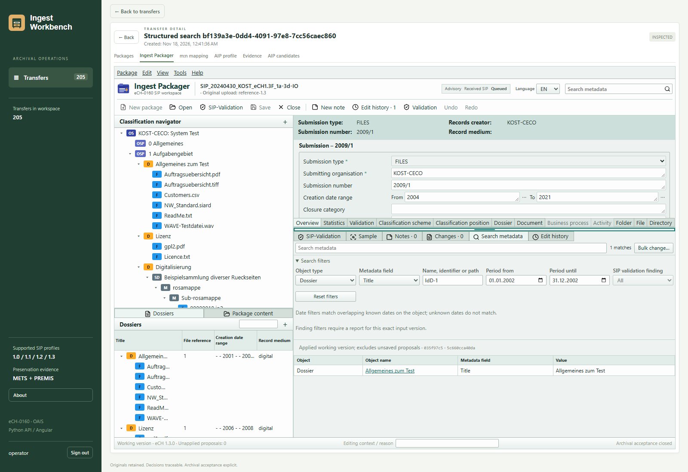

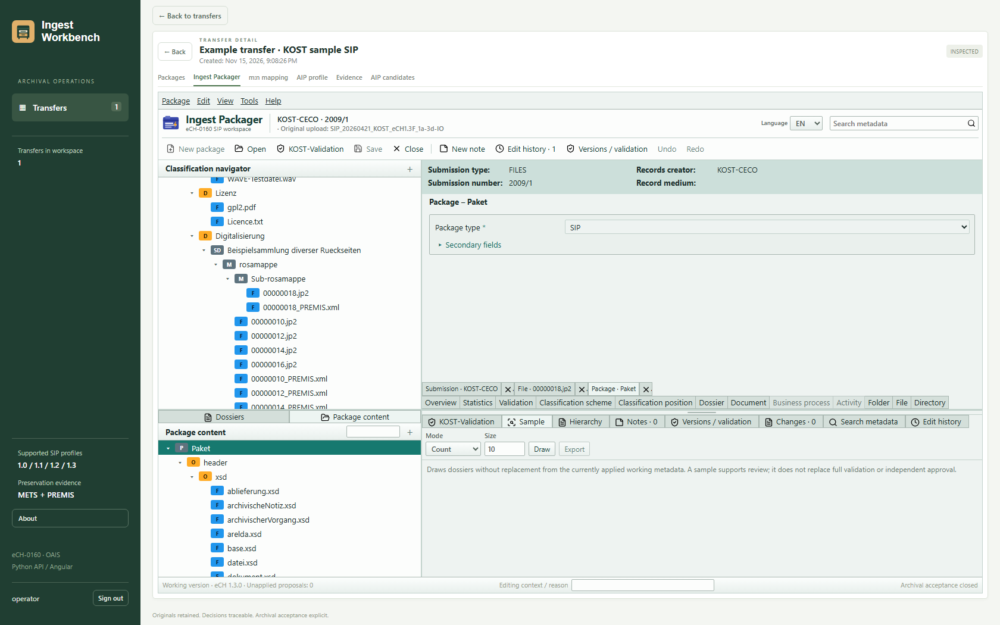

For the retained source rather than working metadata, choose **Package** >
**Inspect original**. The read-only view offers classification and ZIP-member
navigation, source metadata, original downloads and supported text previews.
Switch back to **Edit working metadata** to continue preparation. A prompt
protects unsaved proposals when leaving the editor.

### Rename or replace payload files

Select a payload file in either navigator. **Rename...** in its context menu or
toolbar opens a reviewed filename change; **Replace file content** selects new
bytes without implicitly renaming the file. The Name, ID and checksum fields
remain protected in the metadata form. Header and schema files cannot be changed.

Enter an **Editing context / reason**, choose **Preview content change**, and
review the before/after paths, sizes and SHA-256 digests. Preview does not retain
an operation. Editing the filename, source or reason invalidates that preview.
**Apply content change** records one attributable, retryable operation and one
undo step. Replacement recomputes the submitted checksum using the file's existing
declared algorithm; file IDs, logical references and existing notes remain linked.
Original and replaced bytes stay retained in the preparation evidence.
If an Apply acknowledgement is lost, keep the proposal unchanged and retry
**Apply content change**; the server deduplicates the operation. Closing the
local proposal does not undo an operation already retained by the server.

Use **Package > Download working SIP** for the selected package's current applied
head, excluding pending proposals. Historical file-change events also offer that
exact version's working SIP. This download is not a freeze or an approval.
After applying changes, freeze and independently review a successor before
candidate authorization. **Preview original content** still deliberately shows
the retained original file, not its replacement.

Local limits remain 256 MiB expanded SIP, 64 MiB SIP ZIP and 256 MiB replacement
source. Preparation/freeze evidence has additional 256 MiB expanded / 64 MiB ZIP
limits. A working SIP below its size limit can therefore still exceed the frozen
evidence limit, which includes the prepared SIP and retained history. Refusal
does not discard applied work or publish a partial freeze; earlier versions and
Undo remain available. These are bounded local workflows, not large-scale
streaming qualification.

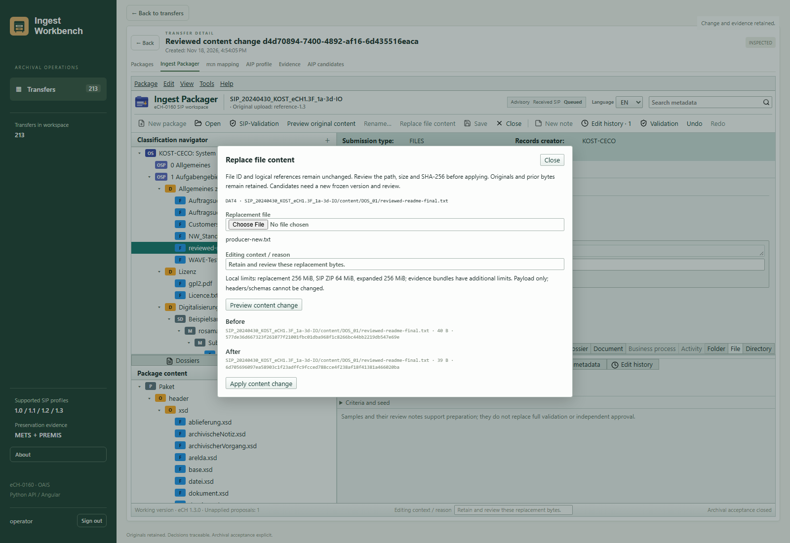

### Preview original file content

Select a file and choose **Preview original content**, then **Load preview**.
The same action is available in **Inspect original**. The dialog always identifies
the retained original SIP and file SHA-256, even when opened from the working
metadata editor. Opening or closing it does not discard unsaved metadata proposals
or record a preparation change.

- Images: PNG, JPEG, GIF, WebP, supported classic TIFF and gray/RGB boxed
  JPEG-2000 (`.jp2`), up to 8 MiB, 8192 pixels per side and 16,000,000 pixels.
  Only the first image/TIFF/animation frame is shown.
- PDF: up to 12 MiB and 200 pages. Use **Previous** and **Next** to change pages.
  Pages are painted onto a canvas; submitted scripts, links, forms and annotations
  are not exposed as interactive content.
- Audio/video: supported WAV, MP3, Vorbis/Opus Ogg, M4A, MP4 and WebM files,
  up to 32 MiB and two hours, using the browser's available codecs and native
  controls. Playback never starts automatically. Video uses the same dimension
  limits as images.

Preview loading/rendering has a 20-second deadline per operation. Source size and
SHA-256 are checked before decoding. Unsupported content, HTML, SVG, oversized
files and decoder errors remain downloadable originals, with an explicit reason
instead of an invented preview. Closing the dialog stops playback and releases
preview resources.

Previews can omit unsupported or oversized content, especially within PDFs;
they are neither fidelity/completeness checks nor format validation. Browser-side
limits are not malware quarantine or isolated parser memory quotas. Previewing
does not change receipt checks, SIP-Validation, candidate authorization or
external archival acceptance.

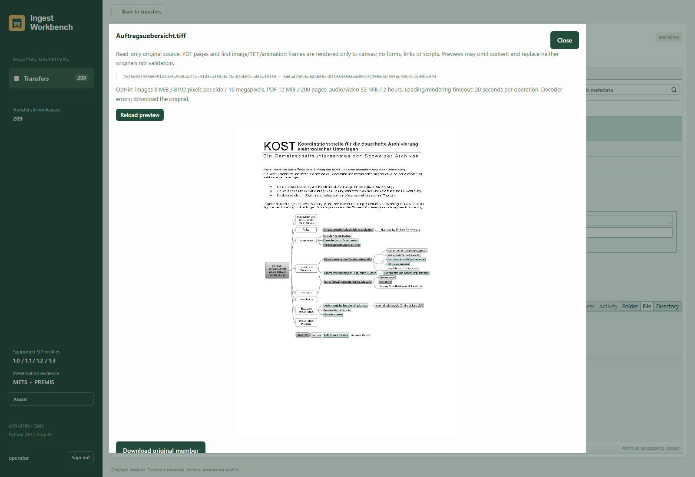

### Inspect preparation statistics

Select **Statistics** below the metadata editor. The version line identifies the
applied operation and metadata SHA-256; the separate source digest identifies
the unchanged original SIP. Unsaved proposals do not contribute.

- **Content files** and **Content size (bytes)** describe retained payload bytes.
  Object-type counts describe canonical metadata objects, including inventory
  files and directories; a shared file is not counted again for each logical
  reference. These counts need not equal the payload-file count.
- Scalar-field indicators show populated and empty schema-exposed fields,
  unsatisfied field/attribute requirements, broken file references and payload
  files without a reference. Optional empty values are not validation failures.
  The indicators do not establish descriptive completeness or archival acceptance
  and do not replace full schema/receipt checks.
- Click a count to inspect its objects or field paths. Larger lists have
  **Previous** and **Next** pages of 100 rows. Selecting an object opens its
  metadata; a field-linked result also reveals the relevant field.
- Format-assessment and finding counts appear only for a SIP-Validation report
  matching this exact original/frozen input. Counts describe report entries,
  not necessarily unique files. Their drilldowns retain the report run/input/
  report digests; unmapped paths and package findings remain visible without
  inventing an object link. An unavailable or different-input report is not
  treated as zero findings or a successful assessment.

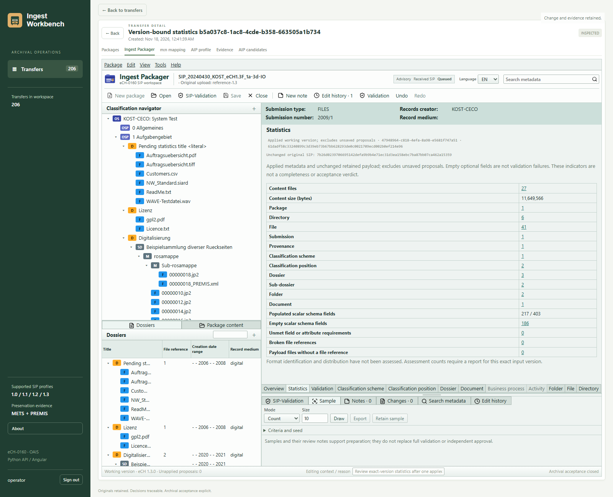

## Prepare metadata and structure

### Change metadata

1. Select an object in a navigator and edit an available field. Required fields
   are marked with an asterisk. Use **Secondary fields** where appropriate.
2. Open **Changes** to inspect pending proposals and their before/after values.
   Proposals remain in the browser until applied or discarded.
3. Select **Save** and supply an **Editing context / reason** when prompted.
   Wait for the operation to finish and check any reported error. Applied
   changes are attributable and retained; the original SIP is not overwritten.
4. Use **Edit history** to inspect events, actors, values and checksums. Open an
   event for details, comparison and evidence downloads. **Undo**, **Redo** and
   supported restore actions require a reason and add history rather than
   erasing it.

**Save** applies all pending field proposals across the opened SIP as one atomic
operation, with one reason, revision and undo step. Its history and METS/PREMIS
evidence retain every field's object identity and before/after values. If any
proposal fails validation or the working baseline changed, none are applied and
the proposals remain available for review. After a lost acknowledgement,
retrying the unchanged save retrieves the same retained operation rather than
applying it again. Reloading or leaving can discard unsaved proposals.

### Apply a reviewed bulk metadata change

1. Save or discard other proposals, then use **Search metadata** and its filters
   to identify the objects to change. **Bulk change…** is available for 1-200
   distinct matching objects with a common editable scalar, single-valued field.
   Protected, structured, attributed and repeated fields are excluded.
2. Select **Bulk change…**, choose the **Metadata field**, enter the **New value
   for all matching objects**, and supply an **Editing context / reason**.
3. Select **Preview bulk change**. The server validates the complete proposal
   against the current baseline and trusted schema without saving it. Review
   every object's **Before** and **After** values. Already-equal values are
   skipped; a proposal with no changes cannot be applied.
4. Select **Apply reviewed changes**. Changing the field, value or reason requires
   a new preview. A stale baseline or invalid field rejects the entire change.

The applied batch retains a shared actor and reason, per-object field evidence,
one revision and one undo step. After a lost acknowledgement, retry **Apply
reviewed changes** without changing the proposal to retrieve the same operation.
This action changes metadata only; it does not rename or move payload files.

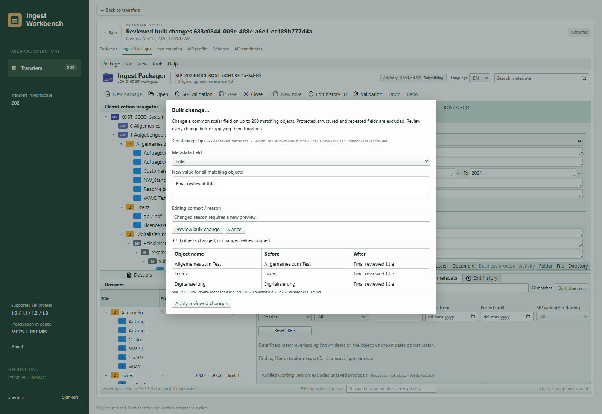

### Import and review external metadata

1. Save or discard other proposals, then select **Tools > Import metadata**.
   Download a CSV, XLSX or JSON template for the selected object, or
   **metadata.xml** for the complete current metadata document.
2. Select an **External metadata file**, supply an **Editing context / reason**,
   and select **Retain import proposal**. This retains the exact original bytes
   and SHA-256 without changing the working XML or adding an undo step.
3. Review every source row, its identity/conflict status, current **Before**
   value and imported **After** value. Resolve unknown identities with
   **Target object** and **Metadata field**. Canonical editor IDs and unique
   native XML IDs are supported. Choose **Use imported value**, or **Exclude**
   with a **Reason for exclusion**, for every row. An external baseline conflict
   is not accepted automatically; protected or unsupported XML changes must be
   excluded.
4. Select **Preview reviewed import**. Review every actual change and the
   proposed metadata digest, then select **Apply reviewed changes**. Changing
   decisions, mappings, exclusion reasons or the editing reason requires another
   preview. A late invalid value rejects the entire application.
5. **Undo** reverses the complete applied import in one step. If all rows are
   excluded, **Retain review without metadata changes** preserves those
   decisions without rewriting XML or adding an undo step.

Supported sources are UTF-8 CSV/JSON (a BOM is accepted), text-only single-sheet
XLSX without formulas, and eCH-0160 XML matching the SIP's trusted profile.
Table rows use `object_id`, `field`, `value` and optional `before`; JSON is an
array of these records. CSV templates use JSON-string `value_json`/`before_json`
columns to preserve exact text without spreadsheet-formula execution. XLSX
templates contain text cells. Limits are 256 KiB per original source, 2,000
source rows, 200 changed/unresolved fields and 4 MiB expanded XLSX data.

Application currently supports editable scalar, single-valued fields only,
not structured/repeated fields, IDs, payload paths, hierarchy or file changes.
An intervening operation makes a proposal historical: use **Create successor
for current version** and review it against the current baseline. Original
sources and prior decisions remain retained in history and METS/PREMIS evidence.
Use **Download original source** to retrieve the exact submitted file. After a
lost acknowledgement, retry the unchanged Retain/Apply action to retrieve the
same operation. None of these preparation decisions is archival acceptance.

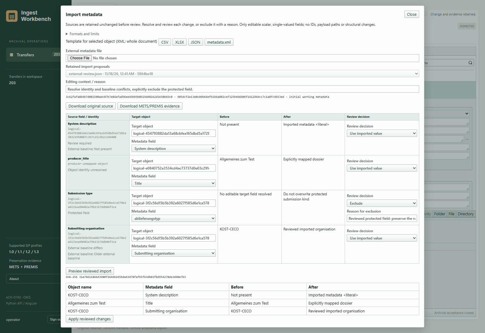

### Work with hierarchy, notes and samples

- Select a suitable parent and use the navigator's **+** button to see available object
  creation actions. Supply the required fields and reason, **Preview
  creation**, inspect the proposal, then **Create objects**. Available object
  types depend on the selected parent and profile.
- Where offered, use an object's context menu to preview a sibling reorder and apply it with a
  reason. Not all moves, deletions, payload edits or SIP creation are implemented.
- Select an object and use **New note** or **Notes** to record object-linked
  preparation context. Notes can be internal or marked as a description
  candidate; they are not published automatically.
- In **Sample**, choose a count or percentage, enter a size and select
  **Draw**. Select a result to open its dossier, or **Export** the CSV.
  Expand **Criteria and seed** to restrict dossier names/references or supply a
  reproducible seed; a blank seed produces a new random seed. Percentage sizes
  round up and the local limit is 500 selections. The result identifies its
  population, algorithm, seed and exact applied metadata version.
- **Draw** remains read-only. To retain its exact selections, use **Retain
  sample** and provide a reason. **Retained samples** reopens earlier draws.
  Unsaved field proposals must be saved or discarded before retaining a draw.
- For a retained sample, choose **Review sample**. Record **Checked** or
  **Issue found** for every selected dossier; issues require a comment. Add a
  reason and use **Retain review**. Actor, time, reason, selections and per-item
  outcomes remain in the preparation history. **Cancel** discards only the
  unapplied review notes.
- **Download sample evidence** downloads METS/PREMIS-linked preparation evidence
  through the latest retained review, or the draw if not yet reviewed. CSV
  export contains the selected names/references, not the complete review
  evidence. Later edits preserve earlier selections, labels and review notes;
  a warning identifies differing current metadata. Selecting an old result
  opens the current object only if that identity still exists.

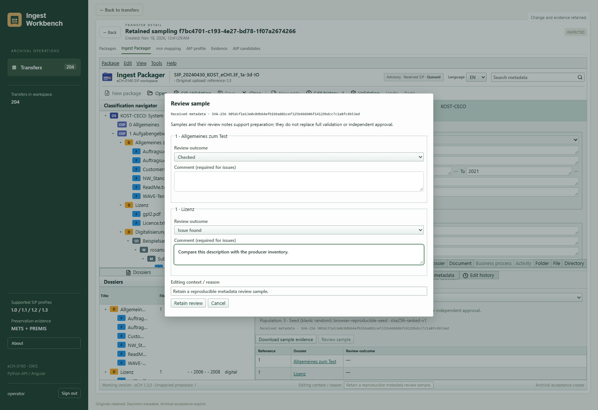

Sampling and sample-review notes support preparation. They do not replace full
validation, an independent review of the selected frozen input, candidate
authorization or external archival acceptance.

See the [gap list](gap-list.md#package-preparation) before relying on a
capability that is disabled or not present.

## Inspect validation results

Open **SIP-Validation** in the packager to inspect advisory external
validation for the received SIP or a frozen input. The external service is
optional and separately operated; **SIP Validator service is not configured**
means it has not been enabled, not that the SIP passed.
This integration relies on the companion
[sip-validator service](https://github.com/baddonkey/sip-validator).

Choose the **Validated artifact**, inspect the status and use **Run SIP
validation** or **Re-run SIP validation** when enabled and authorized.
Existing submissions may be unassessed. A result belongs to the exact selected
bytes and is not transferred to a later working version.

Frozen inputs share the same visible label in **Validation** and
**SIP-Validation**, for example **Snapshot 2 · f06e77de**. The number follows
the snapshot creation order; the suffix is the start of its retained ID.
The SIP-Validation panel also repeats the snapshot reason and creation time.
**Shown in SIP-Validation** marks the matching snapshot card; other cards warn
when a different artifact is selected. Use **Inspect this version's results**
to align the panels. Switching lower tool tabs preserves the artifact choice,
including an explicit choice of **Received SIP**.

When a report is available, filter the package/file table by outcome, severity
or text, expand findings and select a mapped file where available. Download
the retained XML or inspect **Previous runs and reports** for history.
Recognized, not assessed, invalid, service error and validator error are not
passes. An uncertain submission may already have created a remote job: a
confirmed re-run can create a duplicate. Consult the
[KOST operations guidance](specification.md#advisory-kost-sip-validation)
before configuring or troubleshooting the integration.

## Freeze, validate and select a prepared version

Open the packager's **Validation** tab. It stays in the editor rather than
opening an overlay. The workflow is **Working state → Freeze & validate →
Inspect results → m:n arrangement**.

1. Save or discard pending proposals. The view explains what prevents freezing
   and offers those actions beside the working-state status.
2. Enter a **Snapshot reason**, then select **Freeze & validate**. An unchanged
   submission can be frozen directly: the workbench records its initial
   checkpoint automatically. Named checkpoints remain available in **Edit
   history**, but are not a manual prerequisite.
3. Wait for the frozen-version card. Freezing constructs an immutable prepared
   SIP, runs ZIP safety, trusted XSD, submitted-checksum, inventory and reference
   checks, and retains preparation evidence. A failed operation displays an
   error instead of a completed version. Expand **Version identity and SHA-256**
   to inspect its exact identity.
4. Inspect the external status. When configured, SIP-Validation is queued for
   the frozen version automatically. **Inspect this version's results** selects
   that exact artifact in the existing lower SIP-Validation panel. External
   results remain advisory; queued, unavailable, uncertain or missing results
   are not passes and do not automatically block arrangement.
5. When satisfied, select **Use this version for m:n arrangement**. The mapping
   opens with that exact version selected; this does not save the mapping or
   authorize a candidate. Use **Download prepared SIP** and **Download
   METS/PREMIS evidence** as needed.

Further editing remains possible. Pending proposals or a later applied edit
make the old results inapplicable to the current working state. After saving
changes, freeze and validate a successor before using it for arrangement.
Earlier snapshots remain available under **Previous frozen versions**, collapsed
by default, with their own results and downloads. Historical versions cannot
be handed off as the current input. A later checkpoint also creates a new review
boundary, even when the XML bytes are unchanged.

Freezing and its checks do not authorize a candidate or imply archival acceptance.

## Arrange, review and build

### Arrange the selected inputs

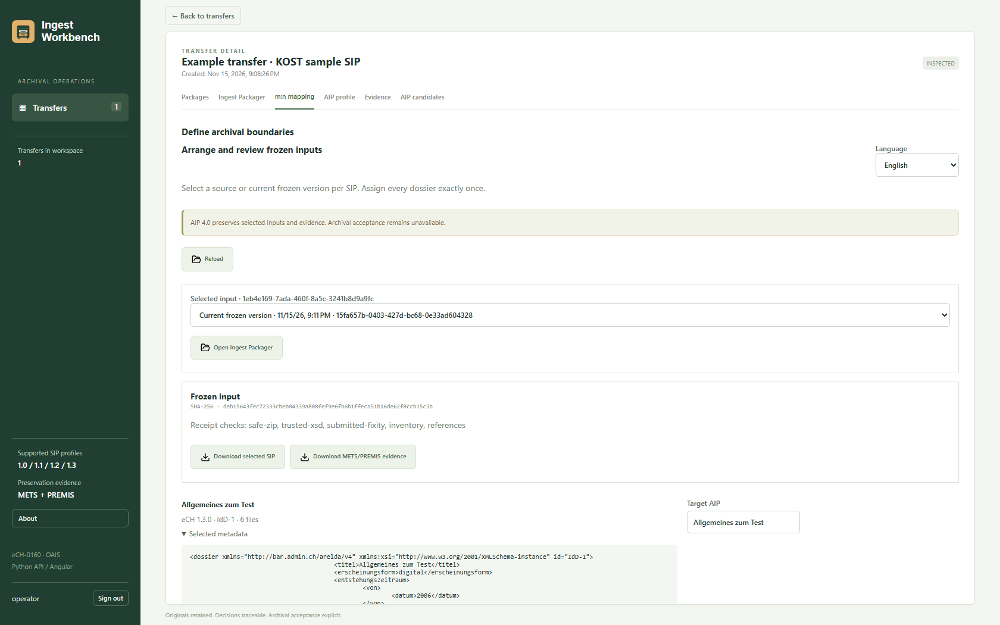

1. Open **m:n mapping**. If working preparation exists, select the current
   frozen version for each affected SIP. Where permitted, an unchanged SIP can
   use its submitted original.
2. Review each selected input, its digest and receipt checks. Expand
   **Selected metadata** to inspect the dossier's metadata.
3. Give every top-level dossier exactly one **Target AIP** label. Use the same
   label to combine dossiers, including dossiers from different SIPs; use
   different labels to create separate candidates. Descendants stay with their
   dossier. Unsupported cross-boundary relationships or shared files can block
   the plan.
4. Enter the **Reason for restructuring** and select **Save frozen-input
   mapping**. A transfer with no working preparation instead offers **Save
   mapping for review** on the original-input path.

### Review and authorize

On the frozen-input path, sign out and sign in as a *different* authorized
reviewer. Reopen the transfer and its mapping; inspect the selected bytes,
receipt findings, context and arrangement. Enter an **Independent review
reason** and select **Record independent preparation review**. Download the
review evidence if needed. Then enter a **Candidate authorization reason** and
select **Authorize AIP candidate** when the reviewer intends that separate
decision.

On the original-input path, the independent reviewer uses **Approve as
reviewer**. The UI shows the actions applicable to the current path and state.
Roles, current revisions and a different authenticated subject are enforced;
changing a selection or later preparation may make review or authorization
stale. Historical evidence remains available.

### Build and inspect candidates

Sign back in as an authorized operator and select the available build action
in **m:n mapping**. Once built, use **AIP candidates** to inspect each
candidate's status, digest and structural/preservation-context results, then
**Verify package** or **Download candidate**. Frozen-input mapping also offers
candidate downloads alongside its review records.

Verification and structural validity are not institutional approval or
preservation readiness. No repository deposit, descriptive-system acceptance
or final archival acceptance is performed by this workflow.

## Evidence and preservation context

The transfer's **Evidence** tab displays the persisted event chain. Expand
**Event details & fixity** for details and the event hash. Packager **Edit
history**, frozen-version evidence and review evidence provide additional
version-specific downloads.

In **AIP profile**, record archive identity, designated community and
knowledge base; preserve supporting documentation and import structured
preservation-context JSON when appropriate. **Check institutional AIP gate**
reports the configured gate; missing rights or format knowledge stays
unassessed. The shipped policy is not institutionally approved. See the
[AIP candidate contract](specification.md#aip-candidates) for details.

## Troubleshooting

| Symptom | What to check |
| --- | --- |
| Workbench or login page unavailable | Check that Podman Machine is running on Windows, then use the Windows launcher and its readiness messages. See [local operations](specification.md#local-development-and-checks). |
| Upload is rejected | Check the selected profile, ZIP size and displayed findings. Do not relabel or upgrade a SIP to bypass validation. |
| A control is disabled | Check your role, transfer state, pending changes, required reason, current version and whether an operation is still running. |
| Freeze & validate is disabled | Read the explanation beside the action: wait for an operation, save or discard proposals, supply a snapshot reason, or use the already-frozen current version. An unchanged submission needs no manual edit or checkpoint. |
| Review or mapping is stale | Reload, select the current frozen input, save the mapping again and obtain a fresh independent review and authorization. |
| SIP Validator is unavailable or a submission is uncertain | Inspect the artifact status and service configuration; do not treat an error or missing report as a pass. Review the uncertain-submission warning before a re-run. |
| A change or save reports an error | Read the message and retained history before retrying. Do not assume a failed response means no operation was recorded. |

Preserve existing `.env` settings and named volumes when restarting. For
recovery, upgrades, PostgreSQL and other operational procedures, follow the
[specification](specification.md) rather than removing data.
