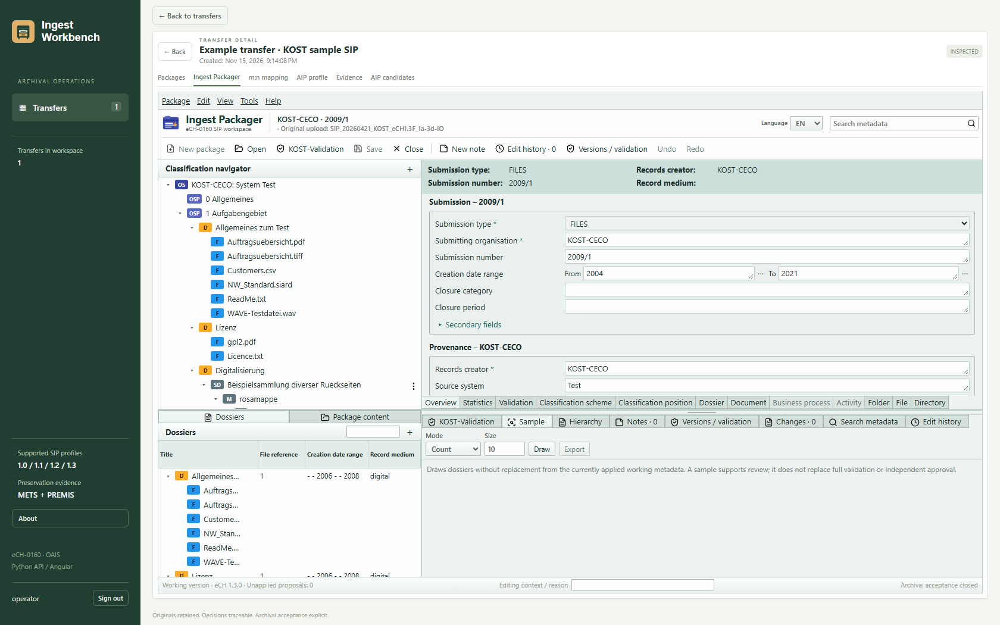
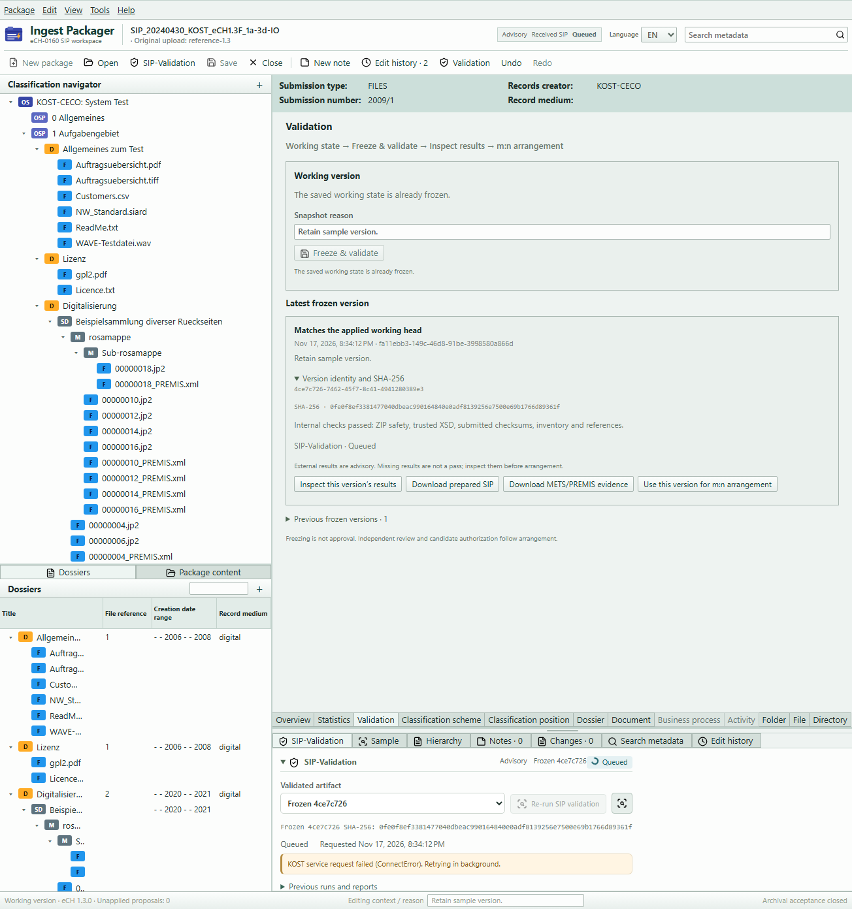

# Ingest Workbench user manual

This guide walks an archivist through a local reference workflow: receiving
eCH-0160 submissions, inspecting and preparing them, arranging dossiers, and
generating AIP candidates. It uses the English interface; some workspace
controls also offer German, French and Italian.

> **Important:** This is an educational reference application, not a production
> archival acceptance system. Receipt checks, optional SIP validation,
> independent review, candidate authorization, institutional approval and
> archival acceptance are different decisions. Building a candidate does not
> deposit it in a repository or accept it in a descriptive system.

The [specification](specification.md) defines the product contract and local
operations. The [gap list](gap-list.md) describes incomplete and unqualified
features. Screenshots in this guide show an isolated demonstration transfer
using a KOST reference SIP; names, counts and dates will differ in your work.

## Contents

- [Get started](#get-started)
- [Receive a SIP](#receive-a-sip)
- [Explore the Ingest Packager](#explore-the-ingest-packager)
- [Prepare metadata and structure](#prepare-metadata-and-structure)
- [Inspect validation results](#inspect-validation-results)
- [Freeze, validate and select a prepared version](#freeze-validate-and-select-a-prepared-version)
- [Arrange, review and build](#arrange-review-and-build)
- [Evidence and preservation context](#evidence-and-preservation-context)
- [Troubleshooting](#troubleshooting)

## Get started

1. Start the local stack as described in the [README](../README.md#start-with-podman).
   On Windows, run `./scripts/start_local.ps1` from the repository root.
2. Open [the workbench](http://localhost:4200/) and sign in through Keycloak.
   The local example realm provides an operator, a reviewer and an auditor;
   credentials and roles are development-only and may have been changed in
   an existing realm. Use your configured account.
3. Use an operator account to create transfers and prepare submissions. An
   independent authorized reviewer is needed for review and authorization;
   a reader can inspect evidence but cannot perform operator actions.

The **Transfers** overview lets you search by title or status and sort by title,
status, SIP count or revision. Select a row to open it. Scroll the list or use
**Load more transfers** for additional results. **Refresh** reloads current
data; the list is not a frozen snapshot.

To try the same kind of example shown below, obtain the eCH 1.3 FILES reference
SIP using the [fixture instructions](specification.md#reference-sip-fixtures).
The sample ZIPs are distributed separately. For your own work, use a SIP you
are authorized to inspect; do not upload sensitive material to a shared demo.

## Receive a SIP

1. In **Transfers**, enter a **New transfer title** and select **Create**.
   The new transfer opens at **Packages**.
2. Under **Add an eCH-0160 SIP**, select the profile declared by the
   submission, choose the ZIP and select **Inspect & add SIP**. The local
   compressed upload limit is 64 MiB.
3. Read any error or finding before continuing. On success the SIP card shows
   **Internal checks passed**, the original upload filename, SHA-256 digest,
   payload count and top-level dossiers. Expand a dossier to inspect its
   submitted metadata.
4. Repeat for additional SIPs in the same transfer while receipt remains
   available. Each SIP keeps its own profile and source evidence.

Select the actual eCH profile: the workbench does not automatically upgrade
submissions. Internal checks include ZIP safety, trusted schema validation,
submitted fixity, inventory and references. A pass is not a format-validation
verdict or archival acceptance. The original bytes remain retained.

## Explore the Ingest Packager

Select **Open Ingest Packager** on a SIP card.

| Area | Use |
| --- | --- |
| **Classification navigator** | Expand or collapse the classification hierarchy and select a record or referenced file. |
| **Dossiers** | Browse dossier descendants and referenced files, with reference, date and medium columns. |
| **Package content** | Browse the physical package and its folder/file hierarchy. |
| Upper-right editor | View the currently selected object's fields; **Secondary fields** reveals more available fields. Select another object in the navigator to switch; there are no open-object tabs to manage. |
| Lower-right tools | Open SIP-Validation, sampling, notes, changes, metadata search or edit history. Object creation and reordering controls open through the navigator actions. |
| Bottom status bar | See pending proposals and enter the **Editing context / reason** used for attributable actions. |

The navigators are independently scrollable. Expand branches to follow nested
dossiers, folders, documents and files. Selecting an item in the classification
navigator reveals and scrolls to it in the active Dossiers or Package content
view, expanding its ancestors and clearing a filter if it hides the selection.
The view switches only if the item is available exclusively in the other view.
The same file can appear
under more than one logical owner without becoming a different file.
Use the horizontal splitter between the editor and tools to give either pane
more space. The search box in the lower navigator filters that navigator;
**Search metadata** searches applied metadata values in the lower-right tools
pane, leaving both navigators and the editor visible. The query and match count
sit above the results table. Selecting an object name opens its metadata in the
editor without closing the search or discarding its results. The header search
box opens the same search pane; results update as you type.

For the retained source rather than working metadata, choose **Package** >
**Inspect original**. The read-only view offers classification and ZIP-member
navigation, source metadata, original downloads and supported text previews.
Switch back to **Edit working metadata** to continue preparation. A prompt
protects unsaved proposals when leaving the editor.

## Prepare metadata and structure

### Change metadata

1. Select an object in a navigator and edit an available field. Required fields
   are marked with an asterisk. Use **Secondary fields** where appropriate.
2. Open **Changes** to inspect pending proposals and their before/after values.
   Proposals remain in the browser until applied or discarded.
3. Select **Save** and supply an **Editing context / reason** when prompted.
   Wait for the operation to finish and check any reported error. Applied
   changes are attributable and retained; the original SIP is not overwritten.
4. Use **Edit history** to inspect events, actors, values and checksums. Open an
   event for details, comparison and evidence downloads. **Undo**, **Redo** and
   supported restore actions require a reason and add history rather than
   erasing it.

Save currently records individual attributable operations, not an atomic
package-wide transaction. If a save reports a failure or a concurrent change,
review the visible result and history before retrying or reloading. Reloading
or leaving can discard unsaved proposals.

### Work with hierarchy, notes and samples

- Select a suitable parent and use the navigator's **+** button to see available object
  creation actions. Supply the required fields and reason, **Preview
  creation**, inspect the proposal, then **Create objects**. Available object
  types depend on the selected parent and profile.
- Where offered, use an object's context menu to preview a sibling reorder and apply it with a
  reason. Not all moves, deletions, payload edits or SIP creation are implemented.
- Select an object and use **New note** or **Notes** to record object-linked
  preparation context. Notes can be internal or marked as a description
  candidate; they are not published automatically.
- In **Sample**, choose a count or percentage, enter a size and select
  **Draw**. Select a result to open its dossier, or **Export** the CSV.
  Sampling is a read-only random aid, not full validation or approval; the
  current tool does not retain version-bound sampling review evidence.

See the [gap list](gap-list.md#package-preparation) before relying on a
capability that is disabled or not present.

## Inspect validation results

Open **SIP-Validation** in the packager to inspect advisory external
validation for the received SIP or a frozen input. The external service is
optional and separately operated; **SIP Validator service is not configured**
means it has not been enabled, not that the SIP passed.
This integration relies on the companion
[sip-validator service](https://github.com/baddonkey/sip-validator).

Choose the **Validated artifact**, inspect the status and use **Run SIP
validation** or **Re-run SIP validation** when enabled and authorized.
Existing submissions may be unassessed. A result belongs to the exact selected
bytes and is not transferred to a later working version.

When a report is available, filter the package/file table by outcome, severity
or text, expand findings and select a mapped file where available. Download
the retained XML or inspect **Previous runs and reports** for history.
Recognized, not assessed, invalid, service error and validator error are not
passes. An uncertain submission may already have created a remote job: a
confirmed re-run can create a duplicate. Consult the
[KOST operations guidance](specification.md#advisory-kost-sip-validation)
before configuring or troubleshooting the integration.

## Freeze, validate and select a prepared version

Open the packager's **Validation** tab. It stays in the editor rather than
opening an overlay. The workflow is **Working state → Freeze & validate →
Inspect results → m:n arrangement**.

1. Save or discard pending proposals. The view explains what prevents freezing
   and offers those actions beside the working-state status.
2. Enter a **Snapshot reason**, then select **Freeze & validate**. An unchanged
   submission can be frozen directly: the workbench records its initial
   checkpoint automatically. Named checkpoints remain available in **Edit
   history**, but are not a manual prerequisite.
3. Wait for the frozen-version card. Freezing constructs an immutable prepared
   SIP, runs ZIP safety, trusted XSD, submitted-checksum, inventory and reference
   checks, and retains preparation evidence. A failed operation displays an
   error instead of a completed version. Expand **Version identity and SHA-256**
   to inspect its exact identity.
4. Inspect the external status. When configured, SIP-Validation is queued for
   the frozen version automatically. **Inspect this version's results** selects
   that exact artifact in the existing lower SIP-Validation panel. External
   results remain advisory; queued, unavailable, uncertain or missing results
   are not passes and do not automatically block arrangement.
5. When satisfied, select **Use this version for m:n arrangement**. The mapping
   opens with that exact version selected; this does not save the mapping or
   authorize a candidate. Use **Download prepared SIP** and **Download
   METS/PREMIS evidence** as needed.

Further editing remains possible. Pending proposals or a later applied edit
make the old results inapplicable to the current working state. After saving
changes, freeze and validate a successor before using it for arrangement.
Earlier snapshots remain available under **Previous frozen versions**, collapsed
by default, with their own results and downloads. Historical versions cannot
be handed off as the current input. A later checkpoint also creates a new review
boundary, even when the XML bytes are unchanged.

Freezing and its checks do not authorize a candidate or imply archival acceptance.

## Arrange, review and build

### Arrange the selected inputs

1. Open **m:n mapping**. If working preparation exists, select the current
   frozen version for each affected SIP. Where permitted, an unchanged SIP can
   use its submitted original.
2. Review each selected input, its digest and receipt checks. Expand
   **Selected metadata** to inspect the dossier's metadata.
3. Give every top-level dossier exactly one **Target AIP** label. Use the same
   label to combine dossiers, including dossiers from different SIPs; use
   different labels to create separate candidates. Descendants stay with their
   dossier. Unsupported cross-boundary relationships or shared files can block
   the plan.
4. Enter the **Reason for restructuring** and select **Save frozen-input
   mapping**. A transfer with no working preparation instead offers **Save
   mapping for review** on the original-input path.

### Review and authorize

On the frozen-input path, sign out and sign in as a *different* authorized
reviewer. Reopen the transfer and its mapping; inspect the selected bytes,
receipt findings, context and arrangement. Enter an **Independent review
reason** and select **Record independent preparation review**. Download the
review evidence if needed. Then enter a **Candidate authorization reason** and
select **Authorize AIP candidate** when the reviewer intends that separate
decision.

On the original-input path, the independent reviewer uses **Approve as
reviewer**. The UI shows the actions applicable to the current path and state.
Roles, current revisions and a different authenticated subject are enforced;
changing a selection or later preparation may make review or authorization
stale. Historical evidence remains available.

### Build and inspect candidates

Sign back in as an authorized operator and select the available build action
in **m:n mapping**. Once built, use **AIP candidates** to inspect each
candidate's status, digest and structural/preservation-context results, then
**Verify package** or **Download candidate**. Frozen-input mapping also offers
candidate downloads alongside its review records.

Verification and structural validity are not institutional approval or
preservation readiness. No repository deposit, descriptive-system acceptance
or final archival acceptance is performed by this workflow.

## Evidence and preservation context

The transfer's **Evidence** tab displays the persisted event chain. Expand
**Event details & fixity** for details and the event hash. Packager **Edit
history**, frozen-version evidence and review evidence provide additional
version-specific downloads.

In **AIP profile**, record archive identity, designated community and
knowledge base; preserve supporting documentation and import structured
preservation-context JSON when appropriate. **Check institutional AIP gate**
reports the configured gate; missing rights or format knowledge stays
unassessed. The shipped policy is not institutionally approved. See the
[AIP candidate contract](specification.md#aip-candidates) for details.

## Troubleshooting

| Symptom | What to check |
| --- | --- |
| Workbench or login page unavailable | Check that Podman Machine is running on Windows, then use the Windows launcher and its readiness messages. See [local operations](specification.md#local-development-and-checks). |
| Upload is rejected | Check the selected profile, ZIP size and displayed findings. Do not relabel or upgrade a SIP to bypass validation. |
| A control is disabled | Check your role, transfer state, pending changes, required reason, current version and whether an operation is still running. |
| Freeze & validate is disabled | Read the explanation beside the action: wait for an operation, save or discard proposals, supply a snapshot reason, or use the already-frozen current version. An unchanged submission needs no manual edit or checkpoint. |
| Review or mapping is stale | Reload, select the current frozen input, save the mapping again and obtain a fresh independent review and authorization. |
| SIP Validator is unavailable or a submission is uncertain | Inspect the artifact status and service configuration; do not treat an error or missing report as a pass. Review the uncertain-submission warning before a re-run. |
| A change or save reports an error | Read the message and retained history before retrying. Do not assume a failed response means no operation was recorded. |

Preserve existing `.env` settings and named volumes when restarting. For
recovery, upgrades, PostgreSQL and other operational procedures, follow the
[specification](specification.md) rather than removing data.
